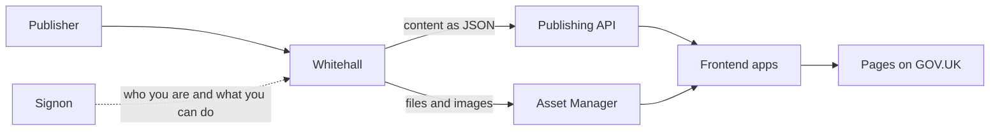
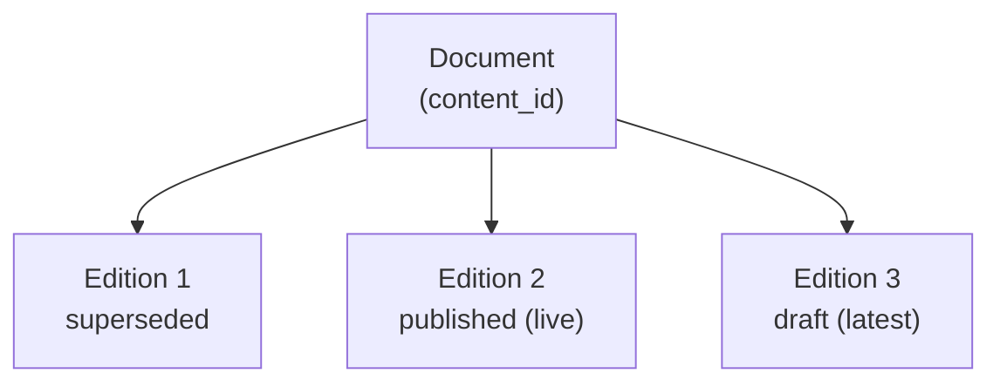
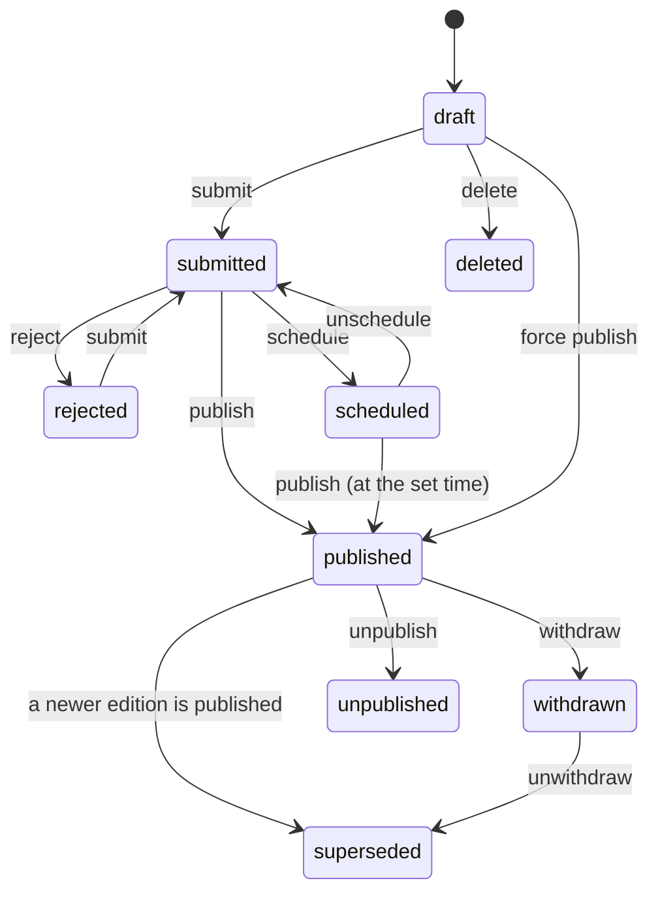
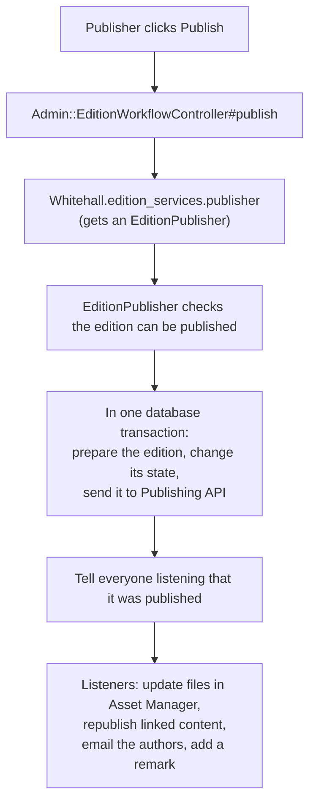

# Getting familiar with Whitehall

This is a "start here" guide to Whitehall. It explains how the app is put together and where to look when you need to change something. It links to the more detailed docs in this folder as you go.

You do not need to read it all at once. Read [What Whitehall is](#what-whitehall-is) and [Key words](#key-words) first, then use [Where do I go if I want to](#where-do-i-go-if-i-want-to) when you have a task.

> The code is always the final source of truth. This guide names files, classes and methods rather than line numbers, so it stays useful as the code changes. If something here no longer matches the code, please fix it.

## Contents

- [What Whitehall is](#what-whitehall-is)
- [Key words](#key-words)
- [Finding your way around the code](#finding-your-way-around-the-code)
- [Documents and editions](#documents-and-editions)
- [The life of an edition](#the-life-of-an-edition)
- [Types of document](#types-of-document)
- [How content is related](#how-content-is-related)
- [Content that is not an edition](#content-that-is-not-an-edition)
- [What happens when you press Publish](#what-happens-when-you-press-publish)
- [Changing what gets sent to GOV.UK](#changing-what-gets-sent-to-govuk)
- [Attachments, images and assets](#attachments-images-and-assets)
- [Offsite links and features](#offsite-links-and-features)
- [Republishing](#republishing)
- [Who can do what](#who-can-do-what)
- [Background jobs](#background-jobs)
- [Tests](#tests)
- [Where do I go if I want to](#where-do-i-go-if-i-want-to)
- [Further reading](#further-reading)

## What Whitehall is

Whitehall is the publishing tool that government departments use to write and publish content on GOV.UK. This includes news, guidance, consultations, organisation pages, ministers' pages and much more.

Whitehall is **only the "back office"**. The public never visits it. It does not render any public GOV.UK pages. Everything it has lives under `/government/admin`, and visiting `/` redirects you there.

When a publisher saves or publishes something, Whitehall sends it to other GOV.UK services:

- **Publishing API** stores the content and passes it to the apps that show it on GOV.UK. It holds a draft copy (for previews) and a live copy (what the public sees).
- **Asset Manager** stores uploaded files, such as PDFs and images.
- **Signon** is the GOV.UK single sign-on. It tells Whitehall who the user is and what permissions they have.

Whitehall also talks to Link Checker API to find broken links. For how to run the app locally, see the [README](../README.md).

## Key words

| Word | What it means | 
|---|---|
| **Document** | One piece of content over its whole life, for example "Budget 2026". It never changes identity. | 
| **Edition** | One version of a document. Each time someone changes published content, they create a new edition. | 
| **content_id** | A unique ID (a UUID) for a document. Other GOV.UK services use it to recognise the content. It belongs to the document, so every edition shares it. | 
| **Slug** | The last part of a page's web address, for example `budget-2026`. | — |
| **Base path** | The full path of the page on GOV.UK, for example `/government/news/budget-2026`. | 
| **Draft and live** | Draft content is only visible to signed-in users in a preview. Live content is public. | 
| **Presenter** | A Ruby class that turns a Whitehall record into the JSON that Publishing API expects. |
| **Sidekiq job** | A piece of work that runs in the background, so the publisher does not have to wait for it. | 
| **Govspeak** | The Markdown-like format publishers write in. | 
| **Edition type** | Which kind of content an edition is, for example `Publication` or `Speech`. | 

## Finding your way around the code

Whitehall is a standard Ruby on Rails app. The folders that matter most are:

| Folder | What lives there |
|---|---|
| `app/models` | The data and the rules about it. This is the heart of Whitehall. |
| `app/models/concerns` | Shared behaviour mixed into models. `concerns/edition/` holds behaviour for editions, such as the publishing workflow. |
| `app/models/configurable_document_types` | JSON files that define "config-driven" document types. See [Types of document](#types-of-document). |
| `app/controllers/admin` | Everything a publisher can click on. Almost every controller is here. |
| `app/views/admin` and `app/components/admin` | The pages publishers see. Components are reusable [ViewComponents](view_components.md): pieces of a page built as a Ruby class plus a template. |
| `app/services` | Classes that do one job, such as publishing or unpublishing an edition. |
| `app/services/service_listeners` | Classes that react after something happens, such as updating files after a publish. |
| `app/presenters/publishing_api` | Turns records into the JSON sent to Publishing API. |
| `app/sidekiq` | Background jobs. |
| `app/uploaders` | File uploads (using the CarrierWave gem). |
| `lib/whitehall` | Whitehall's own libraries, including the Publishing API wrapper and permission rules. |
| `lib/tasks` | Rake tasks: commands you can run from the terminal. |
| `config/initializers/edition_services.rb` | Says what should happen after an edition is published, unpublished and so on. |
| `config/features.rb` | Feature flags. See [feature flags](feature_flags.md). |
| `config/sidekiq.yml` | Background job queues and timed jobs. |
| `db/data_migration` | One-off scripts that fix or change data. See the [data migration guide](../db/data_migration/README.md). |
| `test` | Ruby tests (Minitest). |
| `features` | Browser-based Cucumber tests. |
| `spec` | JavaScript tests (Jasmine) only. Whitehall does not use RSpec. |

## Documents and editions

This is the most important idea in Whitehall.

A **document** is the piece of content as a whole. An **edition** is one version of it. Publishers never edit published content directly. To change it, they create a new draft edition, edit that, and publish it. The old edition is then kept as history.

Things to know:

- A document points to two editions:
  - its **latest edition**, which is the newest one in any state
  - its **live edition**, which is the one the public can see (published or withdrawn). This is empty if the document has never been published or has been unpublished.
- A document can have **only one edition in progress** (draft, submitted or rejected) at a time.
- Each edition stores its own **slug**. A new draft keeps the live edition's slug even if the title changes, so web addresses do not break.
- When you create a new draft, Whitehall copies the previous edition and its related records (such as attachments and images) into it. Each kind of related record registers a small "trait": a hook, added with `add_trait`, that `create_draft` calls to copy that record onto the new draft.
- Every change to an edition is recorded. See [auditing](auditing.md).

Where to look:

- `app/models/document.rb`: `latest_edition`, `live_edition`, `update_edition_references`
- `app/models/edition.rb`: the base class for all editions, and `create_draft`
- `app/models/concerns/edition/identifiable.rb`: content IDs and slugs
- `app/models/concerns/edition/traits.rb`: the copying hooks used by `create_draft`

All editions are stored in one database table, `editions`. The `type` column says which Ruby class each row is, such as `Publication` or `StandardEdition`. Rails calls this **single-table inheritance**: one table, many classes that all inherit from `Edition`.

## The life of an edition

An edition moves through a set of **states**. The rules about which moves are allowed are called a **state machine**.

The diagram leaves out a few rarer moves, such as force scheduling a draft. The full list is in `app/models/concerns/edition/workflow.rb`.

What the states mean:

- **draft**: being written.
- **submitted**: sent for review by a second person.
- **rejected**: the reviewer sent it back.
- **scheduled**: will publish automatically at a set time.
- **published**: live on GOV.UK.
- **superseded**: an older version that a newer edition has replaced.
- **withdrawn**: still on GOV.UK, with a notice saying it is no longer current.
- **unpublished**: removed from GOV.UK, usually replaced by a redirect or a "gone" page.
- **deleted**: a draft that was thrown away. Deleted editions are hidden from normal database queries.

**Force publishing** lets an editor publish without a second person reviewing it. They must give a reason.

Two related features have their own docs:

- **Access limiting** keeps a draft visible only to certain organisations or people. See [access limiting](access_limiting.md).
- **History mode** marks content from a previous government as historical. See [history mode](history_mode.md).

For more detail on unpublishing and withdrawing, see [edition workflow](edition_workflow.md). Unpublishing reasons are listed in `app/models/unpublishing_reason.rb`.

## Types of document

There are two generations of document type in Whitehall. They work side by side while the team moves content from the old way to the new way.

### Older types: one Ruby class each

Each of these is a subclass of `Edition` with its own model, controller and form:

- `Publication`
- `Consultation`
- `CallForEvidence`
- `Speech`
- `DetailedGuide`
- `DocumentCollection`
- `CorporateInformationPage`
- `FatalityNotice`
- `StatisticalDataSet`
- `WorldwideOrganisation`

For example, publications live in:

- `app/models/publication.rb`
- `app/controllers/admin/publications_controller.rb`
- `app/views/admin/publications/`

### Newer types: config-driven "standard editions"

`StandardEdition` (`app/models/standard_edition.rb`) is one class that powers many document types. Each type is described in a JSON file in `app/models/configurable_document_types/`. The file sets:

- the form fields
- what data is valid
- what is sent to Publishing API
- settings such as the page's base path, and whether images, attachments or translations are allowed

The types defined in that folder today are:

- news story, press release, government response and world news story (grouped as "news article")
- case study
- history page
- topical event
- mini site landing page and mini site child page

Some types are still in development. They only appear when the `configurable_document_types` feature flag (an on/off switch in `config/features.rb`) is turned on. See `app/controllers/concerns/document_types_concern.rb` for which types publishers can choose when they create a new document.

Old news article and case study code has already been removed. Topical events are part-way through the move: an older `TopicalEvent` model (marked "LEGACY") still exists next to the new `topical_event` type.

Where to look:

- [Configurable document types](configurable_document_types.md): how the JSON works and every setting
- [Migrating to StandardEdition](migrating_to_standard_edition.md): how an older type is moved over
- `app/models/configurable_document_type.rb`: loads and reads the JSON files
- `app/models/configurable_content_blocks/`: one class per kind of form field
- `app/controllers/admin/standard_editions_controller.rb`: the controller for all standard editions

## How content is related

### Parent and child pages

Some standard edition types can have **child pages**. Today the only example is a mini site landing page with mini site child pages.

- A parent type lists the child types it allows, using the `allowed_child_document_types` setting in its JSON file.
- The link is stored in `ParentChildRelationship`. It joins a parent **edition** to a child **document**. It points to the child's document, not one of its editions, so the link stays the same as the child gets new editions.
- A child page's web address is built from its parent's. For example `/government/my-mini-site/child-page`.
- When the parent gets a new draft, the links to its children are copied to the new draft.

The rules:

1. You can only add a child page while the parent is in a draft-like state (`can_create_new_child_documents?`).
2. A child must be a type the parent allows.
3. You cannot publish a child page until its parent is published (`parent_publication_requirement_met?`).
4. You cannot withdraw a parent while it has published or scheduled children (`has_published_or_scheduled_children?`).
5. You cannot unpublish a parent while it has published, withdrawn or scheduled children (`has_publicly_visible_or_scheduled_children?`).

Where to look:

- `app/models/parent_child_relationship.rb`
- `app/models/concerns/standard_edition/parent_document.rb`: rules 1, 4 and 5
- `app/models/concerns/standard_edition/child_document.rb`: rules 2 and 3
- `app/services/edition_withdrawer.rb` and `app/services/edition_unpublisher.rb`: where rules 4 and 5 stop the action

### Document collections

A **document collection** groups related documents on one page. It has **groups**, and each group has **memberships**. A membership points to a **document**, so the collection always shows that document's live version. A membership can also point to a page outside Whitehall (`DocumentCollectionNonWhitehallLink`).

Look in `app/models/document_collection.rb`, `document_collection_group.rb` and `document_collection_group_membership.rb`.

### Attachments as their own pages

An edition can have attachments. **HTML attachments** are special: each one is published as its own page on GOV.UK, with its own content_id and slug. They are published and unpublished together with their parent edition. See [Attachments, images and assets](#attachments-images-and-assets).

### Consultation outcomes

A `Consultation` can have an `outcome` and `public_feedback`. A `CallForEvidence` can have an `outcome`. These are not editions themselves: they are attached to the consultation's edition and can hold their own attachments.

### Other links between content

Editions can be tagged to organisations, people, roles, world locations and topical events. Each kind of tag is a concern in `app/models/concerns/edition/`, for example `organisations.rb` and `role_appointments.rb`. Links to the GOV.UK topic taxonomy are handled by `app/services/edition_taxon_link_patcher.rb`.

## Content that is not an edition

Some content does not have drafts or versions. When a publisher saves it, the change goes **straight to GOV.UK**.

This includes:

- organisations
- people
- roles and role appointments (who holds a role, and when)
- world locations
- governments
- contacts
- policy groups
- statistics announcements
- the legacy topical events

These models include `PublishesToPublishingApi` (`lib/publishes_to_publishing_api.rb`). It sends the record to Publishing API automatically after every save (`after_commit`). It sends a "gone" message when the record is deleted.

Remember this when you change one of these models: **every save is a publish**.

## What happens when you press Publish

Publishing an edition passes through several layers. Each layer has one job.

1. **Controller.** `app/controllers/admin/edition_workflow_controller.rb` handles the workflow buttons: publish, force publish, schedule, unpublish, withdraw and so on. Saving and deleting drafts are in `app/controllers/admin/editions_controller.rb`.
2. **Service.** The controller asks `Whitehall.edition_services` (an `EditionServiceCoordinator`) for the right service, such as `EditionPublisher`, `EditionUnpublisher` or `EditionScheduler`. All of these are in `app/services`.
3. **The work.** Every service is based on `EditionService`. Its `perform!` method:
   - checks for problems (`failure_reason`)
   - prepares the edition (`prepare_edition`)
   - changes its state (`fire_transition!`)
   - sends the result to Publishing API (`update_publishing_api!`)

   It does all of this inside one database transaction, so if any step fails, nothing is saved.
4. **Sending to Publishing API.** `ServiceListeners::PublishingApiPusher` picks what to send for each action. It uses `Whitehall::PublishingApi` (`lib/whitehall/publishing_api.rb`), Whitehall's wrapper around the Publishing API client.
5. **Listeners.** After the transaction, the coordinator announces what happened, such as "publish". The code in `config/initializers/edition_services.rb` listens for these announcements and runs extra steps, for example:
   - publishing attachment files in Asset Manager
   - updating redirect links on attachments
   - republishing other documents that depend on this one
   - emailing the authors

The last step uses a design pattern called **publish/subscribe** (or "observer"). The service does not need to know about every follow-up task. It announces the event, and anything interested reacts. To add a new follow-up step, subscribe to the event in `config/initializers/edition_services.rb` rather than adding more code to the service.

**Scheduled publishing** works the same way, just later. `EditionScheduler` queues a `ScheduledPublishingJob` to run at the chosen time. When it runs, it uses the `scheduled_publisher` service. If scheduled jobs are lost (for example after restoring a database), run `rake publishing:scheduled:requeue_all_jobs`.

**Why a publish might be blocked.** `EditionPublisher#failure_reasons` collects every reason. Validations that only run when publishing use `on: :publish`. For standard editions, extra checks are in `StandardEdition::PublishingPrerequisites` (`unmet_publishing_prerequisites`).

## Changing what gets sent to GOV.UK

Every model that is sent to Publishing API has a `publishing_api_presenter` method. It names the presenter class to use. For example, `Organisation` uses `PublishingApi::OrganisationPresenter`, and `StandardEdition` uses `PublishingApi::StandardEditionPresenter`.

Presenters live in `app/presenters/publishing_api/`. Each one has:

- a `content` method: the page's content (title, body, details and so on)
- a `links` method: the IDs of related content, such as organisations or people

Shared pieces used by many presenters live in `app/presenters/publishing_api/payload_builder/`. For example, `attachments.rb`, `change_history.rb` and `features.rb`.

Presenter tests are in `test/unit/app/presenters/publishing_api/`. Update them when you change a presenter.

## Attachments, images and assets

**Attachments** belong to an edition (or another "attachable" record). There are three kinds:

| Kind | What it is | Model |
|---|---|---|
| File | An uploaded file, such as a PDF | `FileAttachment`, with the file details in `AttachmentData` |
| HTML | A page written in Whitehall and published as its own GOV.UK page | `HtmlAttachment` |
| External | A link to a file hosted somewhere else | `ExternalAttachment` |

**Images** belong to an edition (`Image`), with the file details in `ImageData`.

All the actual files are stored in **Asset Manager**. Whitehall keeps an `Asset` record for each file it has uploaded, so it knows the file's Asset Manager ID.

How an upload works:

1. The publisher uploads a file. A CarrierWave storage class (`app/uploaders/storage/`) saves it to a temporary folder.
2. `AssetManagerCreateAssetJob` uploads it to Asset Manager in the background. Files on an edition start as **drafts**, so the public cannot see them yet.
3. The job saves an `Asset` record, then updates the edition's draft in Publishing API.

When the edition changes state, listeners in `config/initializers/edition_services.rb` update the files:

| Edition event | What happens to the files | Listener |
|---|---|---|
| Published | Made live (no longer draft) | `ServiceListeners::AttachmentAssetPublisher` |
| Draft deleted | Draft files removed | `ServiceListeners::DraftAttachmentAssetDiscarder` |
| Published, unpublished or unwithdrawn | Redirect address updated | `ServiceListeners::AttachmentRedirectUrlUpdater` |
| Anything else (for example, a draft saved) | Details such as access limits updated | `ServiceListeners::AttachmentUpdater` |

The code that talks to Asset Manager is in `app/services/asset_manager/` and the `AssetManager…` jobs in `app/sidekiq/`.

[Assets](assets.md) goes into much more detail, with flow diagrams for every case and a list of known bugs. Diagrams are in [docs/diagrams](diagrams/).

## Offsite links and features

### What they are

An **offsite link** is a link to a page that is not managed in Whitehall, for example a campaign site or an NHS page. Publishers use them to **feature** that page alongside Whitehall content, such as on an organisation's home page.

A **feature** is an item in a list of highlighted content on a page. A feature can point to a Whitehall document, a topical event or an offsite link.

### Rules

These rules are in `app/models/offsite_link.rb`:

- An offsite link needs a title, summary, link type and URL.
- The link type must be one of `OffsiteLink::LinkTypes.all`, such as `campaign`, `blog_post` or `service`.
- The URL must be on gov.uk, gov.wales or gov.scot, or on one of the sites in `OffsiteLink::PERMITTED_HOSTS` (for example nhs.uk).

### What can have offsite links

Offsite links can belong to:

- organisations
- world location news pages
- legacy topical events
- standard editions whose type has `features_enabled` (today, only topical events)

The link between an offsite link and its owner is stored in `OffsiteLinkParent`.

### How changes reach GOV.UK

- When an offsite link is saved, it **republishes its owner** (`republish_parent_to_publishing_api`). If the owner is an edition, the whole document is republished.
- When a standard edition gets a new draft, its offsite links are copied to the draft. Its features are then pointed at the copies (`Edition::Featurable`, `clone_offsite_links_to`).
- The presenters turn features (including offsite links) into a list called `ordered_featured_documents`. The shared code for this is in `app/helpers/presenters/publishing_api/featured_documents_helper.rb`. Standard editions use it through `PayloadBuilder::Features`.

### Where to look

- Model: `app/models/offsite_link.rb`
- Admin pages: `app/controllers/admin/offsite_links_controller.rb` and `app/views/admin/offsite_links/`
- Features: `app/controllers/admin/features_controller.rb`, `app/models/feature.rb`, `app/models/concerns/edition/featurable.rb` (editions) and `app/models/concerns/featurable.rb` (organisations and world location news)

## Republishing

**Republishing** means sending content to Publishing API again without changing it in Whitehall. You might do this after fixing a bug in a presenter, so that GOV.UK picks up the corrected JSON.

### From the admin pages

Go to `/government/admin/republishing`. Only users with the **GDS Admin** permission can use it. Every republish must have a reason, which is saved as a `RepublishingEvent`.

You can republish:

- **one item**: a document, an organisation, a person, a role, or a special page (such as the ministers index)
- **in bulk**: for example all documents, all documents of one type, all documents from one organisation, or a list of content IDs

### What it does

Republishing a document runs `PublishingApiDocumentRepublishingJob`. It resends the live edition and then any draft, in the right order so the draft is not lost. `Document#republishing_actions` decides exactly which steps to run.

Where to look:

- `app/controllers/admin/republishing_controller.rb`: single items
- `app/controllers/admin/bulk_republishing_controller.rb` and `app/services/bulk_republisher.rb`: bulk
- `app/sidekiq/publishing_api_document_republishing_job.rb`

### Republishing documents with attachments

Rake tasks in `lib/tasks/attachments/` republish documents that have certain kinds of attachments, for example `rake republish_attachments`. They republish the parent documents.

### Republishing files in Asset Manager

Republishing a document **does not** change the files in Asset Manager. It only resends the document's details to Publishing API.

There is no admin page or rake task that resyncs a single file. Developers have used these jobs:

- `AssetManagerAttachmentMetadataJob`: resends a file's details (draft status, access limits, replacements)
- `PublishAttachmentAssetJob`: makes a file live
- `AssetManagerAttachmentRedirectUrlUpdateJob`: updates a file's redirect address

Bigger one-off fixes have been done as [data migrations](../db/data_migration/README.md). [Assets](assets.md) lists the file changes that must be made directly in Asset Manager.

## Who can do what

Users sign in through **Signon**. Signon gives each user a list of **permissions**. These are listed in `User::Permissions` (`app/models/user.rb`), for example:

- `Editor`
- `Managing Editor`
- `GDS Editor`
- `GDS Admin`

A user with none of these is a **writer**.

How Whitehall checks permissions:

- A controller calls `enforce_permission!(action, thing)` (`app/controllers/admin/base_controller.rb`). If the user is not allowed, they see a "permission denied" page.
- `Whitehall::Authority::Enforcer` (`lib/whitehall/authority/enforcer.rb`) picks the right rules class for the thing being checked. Rules classes are in `lib/whitehall/authority/rules/`. For example, `EditionRules` covers editions.
- Some standard edition types are limited to certain organisations, using the `organisations` setting in their JSON file. `ConfigurableDocumentTypeRules` checks this.
- **Access limiting** is a separate check on single editions (`limit_edition_access!`).

[Roles and permissions](roles_and_permissions.md) lists what each permission allows.

## Background jobs

Slow work, or work that talks to other services, runs in the background using **Sidekiq**. Jobs are in `app/sidekiq/`, and most inherit from `JobBase`.

- **Queues** are listed in `config/sidekiq.yml`, for example `publishing_api`, `asset_manager` and `bulk_republishing`. Sidekiq checks them in the order listed.
- **Timed jobs** (like cron jobs) are also set in `config/sidekiq.yml`. They only run in production.
- The **Sidekiq dashboard** is at `/sidekiq`. You need the `Sidekiq Admin` permission.

## Tests

| Folder | What it tests | Tool |
|---|---|---|
| `test/unit` | Models, services, presenters, jobs and so on. Its folders mirror `app/` and `lib/`. | Minitest |
| `test/functional` | Controllers | Minitest |
| `test/integration` | Several parts working together | Minitest |
| `test/components` | ViewComponents | Minitest |
| `features` | Full user journeys in a browser | Cucumber |
| `spec/javascripts` | JavaScript | Jasmine |

- Test data is built with factories in `test/factories/`. A factory is a recipe for making a valid test record, such as `create(:published_publication)`.
- Cucumber tests are slow to run, so the team adds or changes them only when really needed.
- Running `bundle exec rake` runs linting, Minitest, Cucumber and Jasmine. The [README](../README.md) explains how to run tests with GOV.UK Docker.
- [Tips for local development](tips_for_local_development.md) explains how to run a single test.

## Where do I go if I want to

| I want to… | Start here | Read more |
|---|---|---|
| Understand why a publish is blocked | `EditionPublisher#failure_reasons`, validations with `on: :publish`, `StandardEdition::PublishingPrerequisites` | [What happens when you press Publish](#what-happens-when-you-press-publish) |
| Add a step that runs after publishing, unpublishing and so on | `config/initializers/edition_services.rb` | [What happens when you press Publish](#what-happens-when-you-press-publish) |
| Change what is sent to GOV.UK for a type | The model's `publishing_api_presenter`, then `app/presenters/publishing_api/` | [Changing what gets sent to GOV.UK](#changing-what-gets-sent-to-govuk) |
| Add or change a field on a news story, case study and so on | The type's JSON in `app/models/configurable_document_types/` | [Configurable document types](configurable_document_types.md) |
| Add a new config-driven document type | A new JSON file, plus `app/controllers/concerns/document_types_concern.rb` so publishers can choose it | [Configurable document types](configurable_document_types.md) |
| Change a legacy type, such as publications | `app/models/publication.rb`, `app/controllers/admin/publications_controller.rb`, `app/views/admin/publications/` | [Types of document](#types-of-document) |
| Understand parent and child pages | `app/models/concerns/standard_edition/parent_document.rb` and `child_document.rb` | [Parent and child pages](#parent-and-child-pages) |
| See how documents relate to editions | `app/models/document.rb`, `app/models/edition.rb` | [Documents and editions](#documents-and-editions), [edition model](edition_model.md) |
| Change the rules for offsite links | `app/models/offsite_link.rb` | [Offsite links and features](#offsite-links-and-features) |
| Change how offsite links appear on GOV.UK | `app/helpers/presenters/publishing_api/featured_documents_helper.rb` | [Offsite links and features](#offsite-links-and-features) |
| Republish a document, organisation, person or role | `/government/admin/republishing` (GDS Admin only) | [Republishing](#republishing) |
| Republish lots of content | `/government/admin/republishing` bulk options, `app/services/bulk_republisher.rb` | [Republishing](#republishing) |
| Fix an attachment or image file | `app/services/asset_manager/`, `AssetManager…` jobs in `app/sidekiq/` | [Republishing files in Asset Manager](#republishing-files-in-asset-manager), [assets](assets.md) |
| Change what happens to files on publish or unpublish | `app/services/service_listeners/` (the attachment listeners) | [Attachments, images and assets](#attachments-images-and-assets) |
| Change who can do something | `lib/whitehall/authority/rules/` | [Who can do what](#who-can-do-what), [roles and permissions](roles_and_permissions.md) |
| Hide a draft from other departments | `app/models/concerns/edition/limited_access.rb` | [Access limiting](access_limiting.md) |
| Change how a state change works | `app/models/concerns/edition/workflow.rb` and the matching service in `app/services` | [The life of an edition](#the-life-of-an-edition) |
| Change how scheduled publishing works | `app/services/edition_scheduler.rb`, `app/sidekiq/scheduled_publishing_job.rb` | [What happens when you press Publish](#what-happens-when-you-press-publish) |
| Run a one-off data fix | A new script in `db/data_migration/`, run with `rake db:data:migrate` | [Data migrations](../db/data_migration/README.md) |
| Change a web address (slug) | `rake reslug:…` tasks in `lib/tasks/reslugging.rake` | — |
| Prepare for a change of government | `lib/tasks/election.rake` | [History mode](history_mode.md) |
| Hide a feature until it is ready | `config/features.rb` | [Feature flags](feature_flags.md) |
| Add a page component | `app/components/admin/` | [View components](view_components.md) |
| Fix a broken link checker report | `app/services/link_checker_api_service.rb` | [Link Checker API](link_checker_api_integration.md) |

## Further reading

Detailed guides in this folder:

- [Access limiting](access_limiting.md): limiting drafts to certain organisations or people, and preview links
- [Analytics](analytics.md): how page tracking works in the admin pages
- [Assets](assets.md): files, images and Asset Manager in depth
- [Auditing](auditing.md): how changes are recorded
- [Browser support](browser_support.md)
- [Configurable document types](configurable_document_types.md): the JSON-driven types
- [Contacts expansion](contacts_expansion.md): how contact details are embedded in content
- [CSS](css.md) and [JavaScript](javascript.md): front-end conventions
- [Edition model](edition_model.md): documents and editions, with a diagram
- [Edition workflow](edition_workflow.md): states, unpublishing and withdrawing
- [Email delivery](email_delivery.md): emails Whitehall sends to its own users
- [Feature flags](feature_flags.md)
- [History mode](history_mode.md): political content and changes of government
- [Internationalisation](internationalisation_guide.md): translations
- [Link Checker API](link_checker_api_integration.md)
- [Migrating to StandardEdition](migrating_to_standard_edition.md)
- [Pushing content to Publishing API](pushing_content_to_publishing_api.md): republishing after setting up local data
- [Roles and permissions](roles_and_permissions.md)
- [Timestamps](timestamps.md): what each date field means
- [Tips for local development](tips_for_local_development.md)
- [Troubleshooting](troubleshooting.md)
- [View components](view_components.md)

Architecture decision records (ADRs), which explain why big decisions were made, are in [docs/adr](adr/). ADR 0004 describes Content Block Manager, which has since been removed from this repository.
